<p align="center">
  <picture>
    <source media="(prefers-color-scheme: dark)" srcset="assets/logo/logo-lockup-dark.svg">
    
  </picture>
</p>

# Allo Health

Allo Health is a personal health dashboard for iPhone and Android. It reads the data your phone and wearables already collect, such as heart rate, HRV, sleep, activity and nutrition, and turns it into one calm daily view of how recovered you are and how hard to push today.

Everything is computed on your device. Your health data never leaves your phone.

## Screenshots

Shown with the built-in sample data. Allo Health follows a dark or light theme, or your phone's setting.

| | Today | Fitness | Biomarkers | VO₂ max | Journal | Readiness | Quick add |
| --- | --- | --- | --- | --- | --- | --- | --- |
| **Dark** | 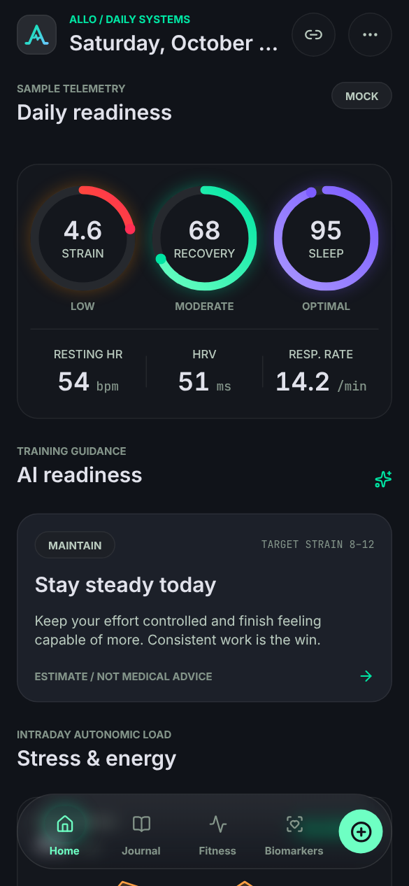 | 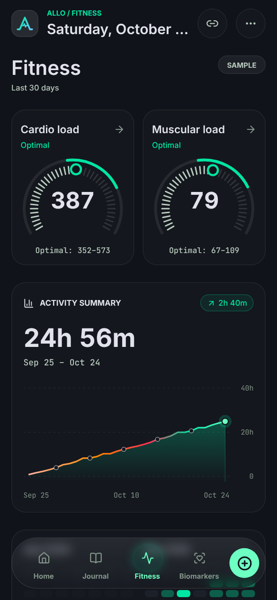 | 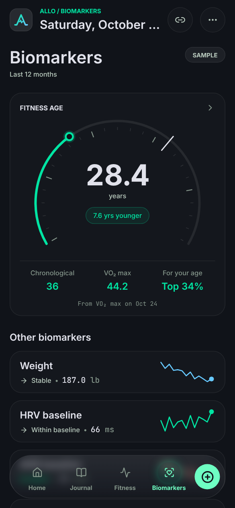 | 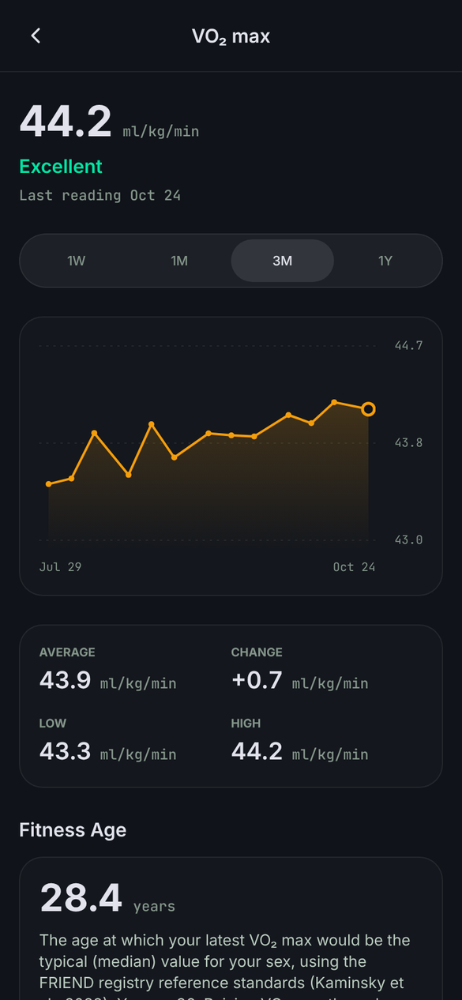 | 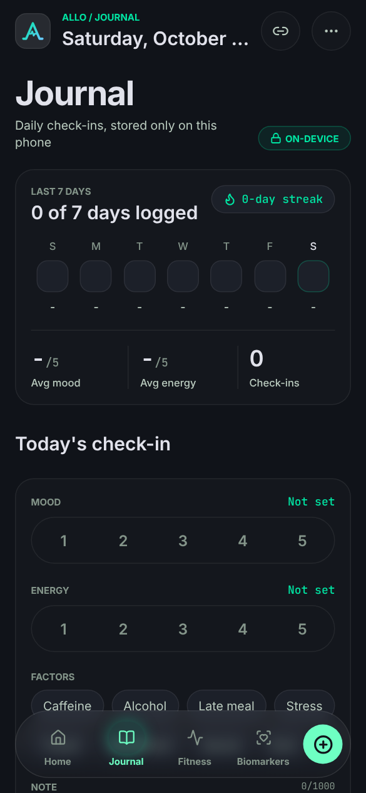 | 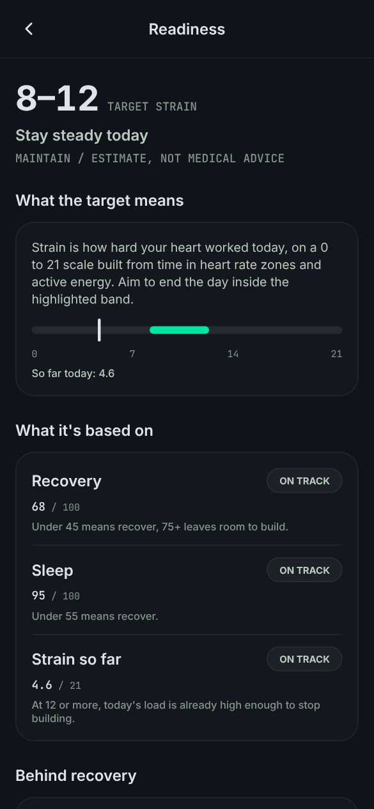 | 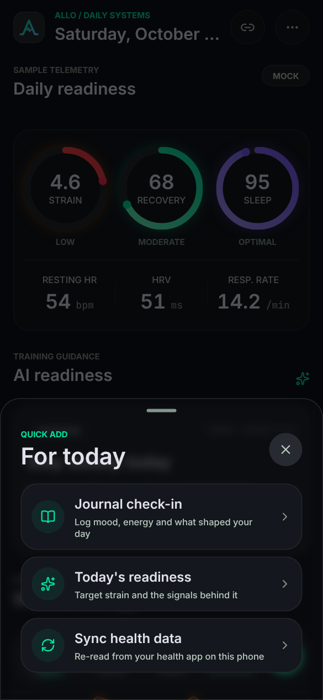 |
| **Light** | 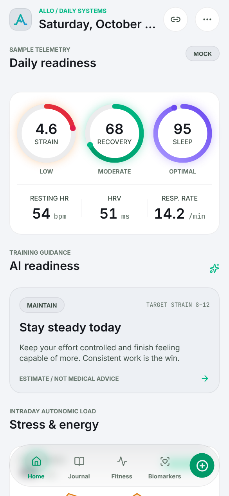 | 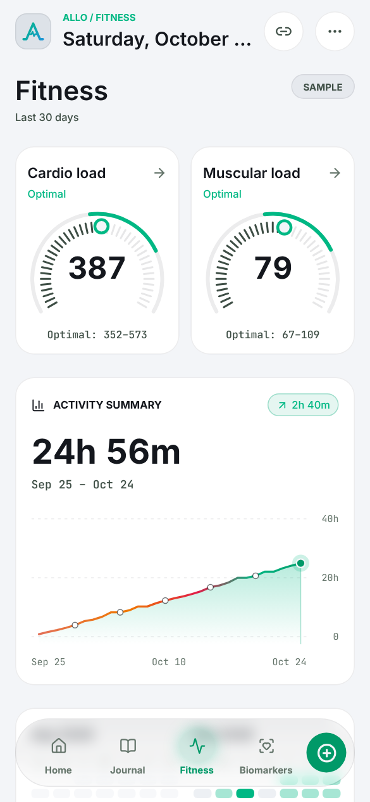 | 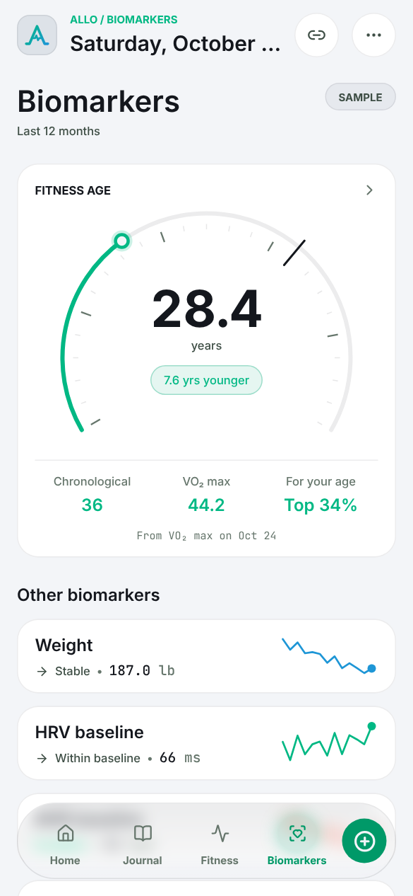 | 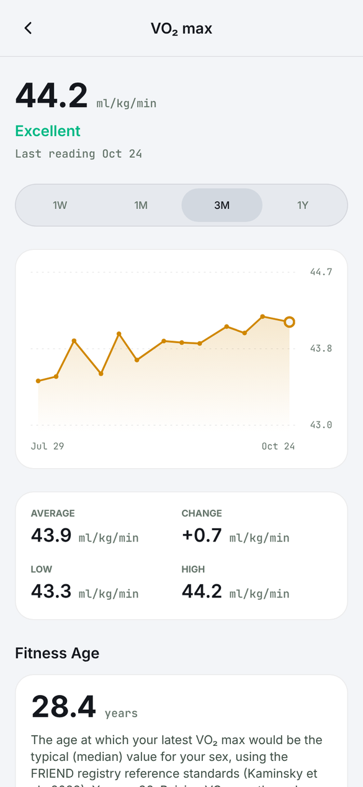 | 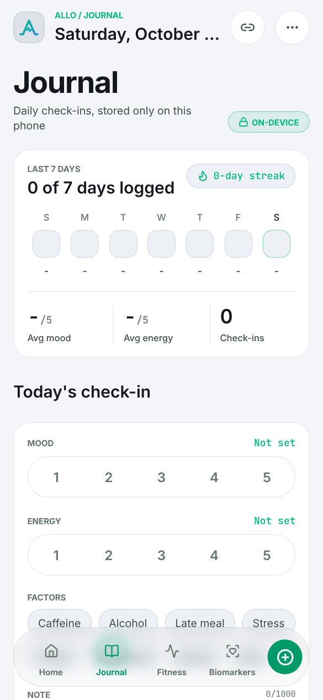 | 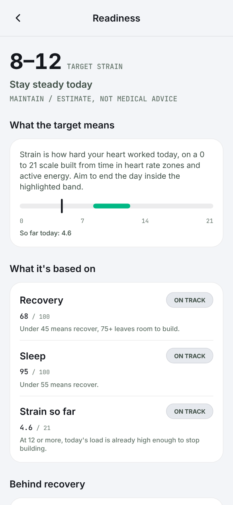 | 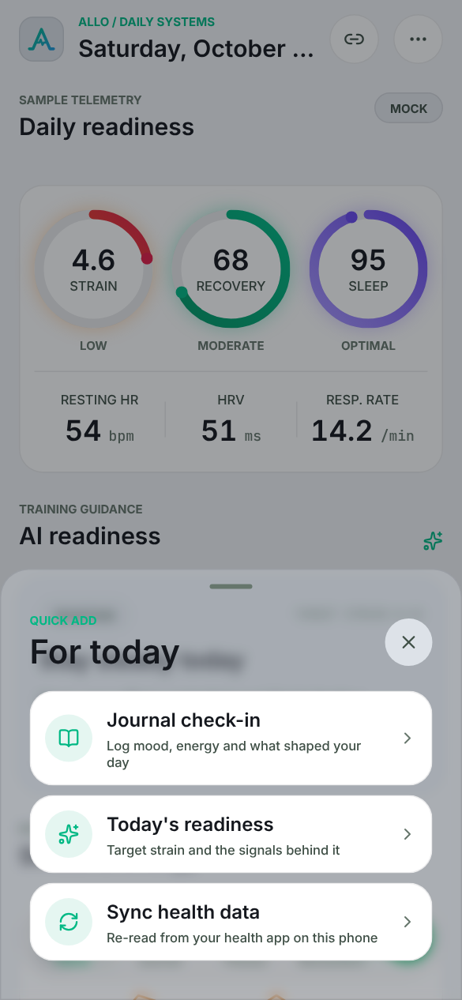 |

## What you get

**Today**

- **Daily readiness.** Recovery, sleep and strain scores built from your resting heart rate, heart rate variability, sleep and active energy.
- **Training guidance.** A daily recommendation to push, maintain or recover, with a target strain range for the day.
- **Stress and energy.** An estimate of today's stress load and an energy "battery" that charges with sleep and drains with strain and stress.
- **Nutrition and glucose.** Calories, macros and glucose readings, shown when your health source shares them.

**Fitness**

- **Training load.** Cardio and muscular load gauges that compare your last 7 days with your usual week.
- **Activity summary.** Active time over the last 30 days compared with the 30 before, and an activity calendar shaded by how many sessions you did each day.
- **Cardio.** Active duration and energy this week against last week, VO₂ max, heart-rate recovery, cardio focus and time in heart-rate zones, each with its own detail page.

**Biomarkers**

- **Fitness age.** The age your VO₂ max matches, compared with your real age.
- **Trends.** Weight, body fat, lean mass, HRV, resting heart rate, VO₂ max, blood oxygen and respiratory rate, each with a trend against your recent baseline and a detail page with history.

**Journal**

- **Daily check-in.** Mood, energy and habits like caffeine, alcohol or late meals, with a weekly overview. Entries are stored only on your phone.

**Settings**

- Tap the ••• button to re-sync your health data on demand and choose a dark, light or system theme.

Units follow your region (for example mg/dL or mmol/L for glucose, kcal or kJ for energy), and times follow your phone's 12 or 24 hour setting.

## Your data stays on your phone

Privacy is the core design rule of Allo Health, not a setting.

- **Read only.** The app asks Apple Health or Health Connect for read access only. It never writes to your health records.
- **No network requests with health data.** Scores, estimates and guidance are calculated locally. Nothing is uploaded to a server.
- **No analytics or tracking.** There are no analytics SDKs, crash reporters or ad trackers in the app.
- **You stay in control.** You can revoke access at any time in the Health app on iPhone or in Health Connect on Android.

## Where the data comes from

| Platform | Health source |
| --- | --- |
| iPhone | Apple Health (HealthKit) |
| Android 8.0 and newer | Health Connect |

Any app or wearable that syncs into Apple Health or Health Connect, such as Apple Watch, Garmin, Oura, Withings or Samsung Health, can feed the dashboard.

Until you connect a health source, Allo Health shows realistic sample data so you can explore the app first. It only asks for permissions when you tap connect, and if access is not granted it says so clearly and keeps showing sample data. Once connected, it reconnects on its own each time you open it, without asking again.

A note on Apple Health: iOS does not tell apps which individual data types you declined. If a card shows a signal as unavailable, check that Allo Health is allowed to read it under Settings › Health › Data Access & Devices.

## Not medical advice

Allo Health's scores and guidance are informational estimates to help you notice trends. They are not a diagnosis or a substitute for advice from a doctor or other qualified professional.

## Running it yourself

Allo Health is not in the App Store or Google Play yet. To build and run it on your own device or a simulator, follow the [local development guide](docs/DEVELOPMENT.md). The project uses [Bun](https://bun.sh) as its package manager:

```sh
bun install
bun run ios       # or: bun run android
```

## License

Allo Health is open source under the [MIT License](LICENSE).
